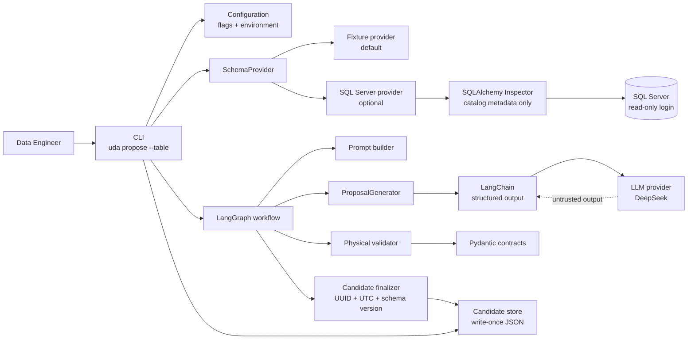
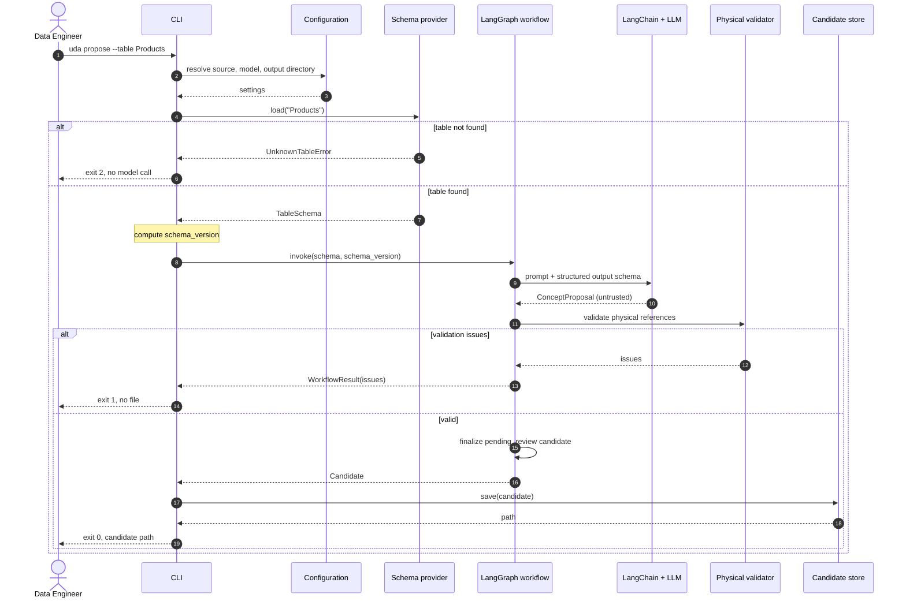
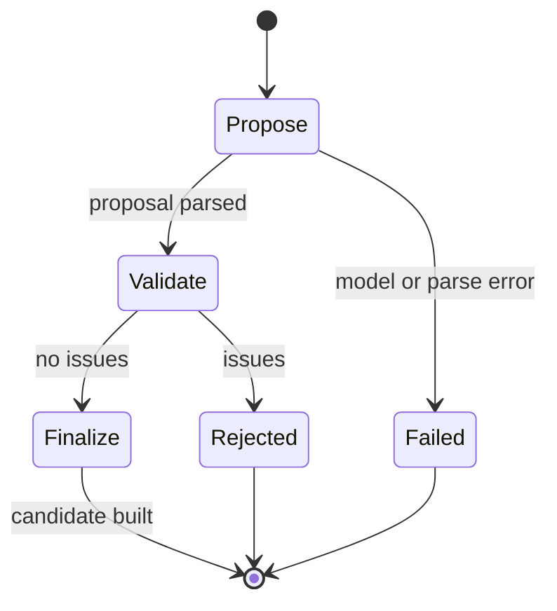

# UDA Vertical Slice - Architecture

- **Status:** Target design (Stage 1). No application code is changed by this document.
- **Date:** 2026-11-20
- **Companion documents:** [requirements.md](requirements.md), [decisions.md](decisions.md)

## 1. Context and goals

The slice turns one selected table into one unapproved candidate. The architecture
keeps four concerns separate:

1. **Schema access** - fixture by default, optional read-only SQL Server metadata.
2. **Proposal generation** - LangChain structured output from an untrusted model.
3. **Physical validation** - an independent check of every table and column reference.
4. **Persistence** - a write-once `pending_review` candidate with provenance.

The central rule is: *a model output is never a candidate until an independent
validator has checked it against the physical schema.*

## 2. Component diagram



The dashed edge marks the trust boundary: model output enters the system as data,
not as an instruction or a candidate.

## 3. Target package layout

```text
week08/universal-database-access/
├── docs/
│   ├── requirements.md
│   ├── architecture.md
│   └── decisions.md
├── src/uda/
│   ├── __init__.py
│   ├── __main__.py
│   ├── models.py          # Column, TableSchema, AttributeMapping, ConceptProposal, Candidate
│   ├── schema.py          # SchemaProvider protocol, fixture provider, UnknownTableError
│   ├── sqlserver.py       # optional SQL Server provider (SQLAlchemy Inspector only)
│   ├── prompt.py          # schema-to-prompt rendering
│   ├── provider.py        # chat-model factory (DeepSeek, optional extra)
│   ├── proposal.py        # ProposalGenerator protocol + LangChain adapter
│   ├── validation.py      # validation issues and physical-reference checks
│   ├── candidate.py       # candidate finalization: ID, timestamp, status
│   ├── storage.py         # write-once JSON persistence
│   ├── workflow.py        # LangGraph state, nodes, edges, result
│   ├── config.py          # CLI/environment resolution and secret-safe errors
│   ├── cli.py             # `uda propose` entry point
│   └── fixtures/
│       └── demo_schema.json
├── tests/
│   ├── fixtures/
│   ├── test_models.py
│   ├── test_schema_fixture.py
│   ├── test_sqlserver.py
│   ├── test_prompt.py
│   ├── test_proposal.py
│   ├── test_validation.py
│   ├── test_candidate.py
│   ├── test_storage.py
│   ├── test_workflow.py
│   ├── test_config.py
│   └── test_cli.py
├── pyproject.toml
└── README.md
```

The current implementation predates this target. Stage 2 and later will align the
modules; Stage 1 changes only `docs/`.

## 4. Components and interfaces

| Component | Responsibility | Input | Output | Failure |
|---|---|---|---|---|
| `SchemaProvider` | Resolve one table to a complete schema. | Table reference | `TableSchema` | `UnknownTableError` |
| Fixture provider | Read the bundled or user-supplied JSON fixture. | Table reference, path | `TableSchema` | `UnknownTableError`, fixture error |
| SQL Server provider | Read columns, types, nullability, and primary-key metadata. | Table reference, connection settings | `TableSchema` | connection/metadata error |
| Schema versioning | Fingerprint canonical schema metadata. | `TableSchema` | `sha256:<hex>` | schema validation error |
| `ProposalGenerator` | Turn a rendered prompt into a structured proposal. | Prompt messages | `ConceptProposal` | `ModelOutputError` |
| LangChain adapter | Call a chat model with a Pydantic structured-output schema. | Prompt, model | `ConceptProposal` | provider/parse error |
| Validator | Check every physical reference and mapping invariant independently of the model. | `TableSchema`, `ConceptProposal` | ordered issues | none; issues are data |
| Candidate finalizer | Assign ID and timestamp, copy source and schema version, set status. | Schema, version, proposal | `Candidate` | invalid proposal |
| Candidate store | Revalidate and persist exactly once. | `Candidate`, directory | file path | `CandidateStorageError` |
| `Workflow` | Orchestrate propose, validate, finalize. | Schema, generator | `WorkflowResult` | model error |
| CLI | Resolve settings, select provider, invoke workflow, report outcomes. | argv, environment | exit code | configuration/input error |

Interfaces are expressed as protocols or plain callables so tests can replace the
model, the clock, the ID factory, and the catalog inspector without network or
database access.

## 5. Data flow

### 5.1 Fixture path (default)

1. CLI parses `--table`, `--source`, `--fixture`, and `--out-dir`.
2. Configuration resolves defaults and environment overrides without logging secrets.
3. The fixture provider finds the table; an unknown table stops before any model call.
4. The table is normalized into a `TableSchema` with SQL types, nullability, and
   primary-key flags.
5. The schema version is computed from canonical metadata.
6. LangGraph receives the schema and version.
7. `propose` renders a prompt and calls the LangChain structured-output adapter.
8. `validate` checks every mapping against the schema.
9. `finalize` builds a `Candidate` with UUID, UTC timestamp, source table, schema
   version, and `pending_review`.
10. The CLI asks the store to revalidate and write the candidate once.

### 5.2 SQL Server path (optional)

Steps 1-4 differ: the provider uses SQLAlchemy's Inspector to read catalog metadata.
It calls column and primary-key inspection methods only. It does not construct SQL,
does not execute user-supplied SQL, and does not write to the database. Steps 5-10
are identical, so the fixture and SQL Server paths share validation and persistence.

### 5.3 Failure behavior

- Unknown table: exit `2`, no model call, no file.
- Unknown column or duplicate mapping: exit `1`, no file.
- Model parse/provider failure: exit `2`, no file.
- Storage failure or existing target file: exit `2`, no partial file.

## 6. Sequence diagram



The sequence deliberately places validation after the model call and persistence
after validation. The model cannot write a file; only the CLI, through the store,
can persist a candidate.

## 7. LangGraph workflow

### 7.1 State

| Field | Type (description) | Produced by | Consumed by |
|---|---|---|---|
| `table_name` | Requested table reference | CLI | Propose, diagnostics |
| `schema` | Validated `TableSchema` | Provider | Propose, Validate, Finalize |
| `schema_version` | Fingerprint string | Versioning | Finalize |
| `proposal` | `ConceptProposal` or `None` | Propose | Validate, Finalize |
| `issues` | Ordered `ValidationIssue` tuple | Validate | Result, routing |
| `candidate` | `Candidate` or `None` | Finalize | Result |
| `error` | Error text or `None` | Propose/Validate | Result, routing |

State is explicit so each stage is independently testable and observable. The graph
does not persist candidates; persistence is a CLI boundary after the graph returns.

### 7.2 Nodes and edges

| Node | Behavior |
|---|---|
| `propose` | Render the schema prompt, call the `ProposalGenerator`, store the proposal or an error. |
| `validate` | Run physical-reference validation; store ordered issues. |
| `finalize` | Build a `pending_review` candidate with ID, timestamp, source, and schema version. |

Edges:

- `START -> propose`
- `propose -> validate` when a proposal exists, otherwise `propose -> END`
- `validate -> finalize` when there are no issues, otherwise `validate -> END`
- `finalize -> END`

### 7.3 State diagram



The vertical slice has no retry loop. A malformed model response ends the run with
an error; it is never coerced into a candidate.

## 8. Validation boundaries

| Boundary | Enforced by | Rejects |
|---|---|---|
| **Table selection** | Schema provider | Unknown table, before any model call |
| **Schema shape** | Pydantic contracts | Missing table/columns, empty or duplicate columns, malformed PK flag |
| **Model output** | LangChain structured output plus Pydantic | Missing fields, extra fields, empty attributes, duplicate attribute names |
| **Physical references** | Independent validator | Unknown columns, duplicate columns in one mapping, column reuse across attributes |
| **Status** | Candidate model | Any status other than `pending_review` |
| **Persistence** | Candidate store | Invalid candidate, existing target file, partial write |

Case-insensitive resolution is used for table and column names, matching SQL Server's
default collation. Accepted names are canonicalized to the schema's exact spelling
before the candidate is saved. The schema loaded at the start of a run is the
snapshot used for validation and versioning; the run does not re-read the catalog.

## 9. Configuration

| Setting | CLI | Environment | Default |
|---|---|---|---|
| Table | `--table` (required) | - | - |
| Schema source | `--source` | `UDA_SCHEMA_SOURCE` | `fixture` |
| Fixture path | `--fixture` | `UDA_FIXTURE_PATH` | bundled fixture |
| Candidate directory | `--out-dir` | `UDA_CANDIDATES_DIR` | `candidates/` |
| SQL Server host | - | `UDA_DB_SERVER` | - |
| SQL Server database | - | `UDA_DB_DATABASE` | - |
| SQL Server user | - | `UDA_DB_USER` | - |
| SQL Server password | - | `UDA_DB_PASSWORD` | - |
| ODBC driver | - | `UDA_DB_DRIVER` | `ODBC Driver 18 for SQL Server` |
| Encryption | - | `UDA_DB_ENCRYPT` | `yes` |
| Trust server certificate | - | `UDA_DB_TRUST_SERVER_CERTIFICATE` | `yes` (local development) |
| DeepSeek key | - | `DEEPSEEK_API_KEY` | - |
| Model name | - | `UDA_MODEL` | `deepseek-chat` |
| Model base URL | - | `UDA_BASE_URL` | `https://api.deepseek.com` |
| Offline replay | `--response-file` | - | - |

Rules:

- CLI flags override environment defaults.
- Secrets are read from the environment only; they never appear in prompts, fixtures,
  logs, candidate files, or error text.
- SQL Server settings are required only when `--source sqlserver` is selected.
- Offline tests inject a fake generator and never resolve provider credentials.
- Values containing spaces or backslashes in `.env` must be single-quoted.

## 10. Error handling and exit codes

| Condition | Exit code | Candidate file | Notes |
|---|---|---|---|
| Candidate written | `0` | Yes | Print candidate ID and path. |
| Validation issues | `1` | No | Print each issue code and message. |
| Unknown table | `2` | No | Stop before the model call. |
| Missing or invalid configuration | `2` | No | Name the missing setting, never its value. |
| Model/provider/parse failure | `2` | No | Report a safe error; do not include secrets. |
| Storage failure or existing target | `2` | No | No partial or overwritten file. |

Errors are data at the workflow boundary and exit codes at the CLI boundary. The
workflow does not call `sys.exit`, and the store does not decide policy.

## 11. Why LangChain and LangGraph are not interchangeable

They operate at different layers.

| Concern | LangChain | LangGraph |
|---|---|---|
| Chat-model clients and provider adapters | Yes | No |
| Messages, prompts, roles | Yes | No |
| Structured output and Pydantic parsing | Yes | No |
| Explicit shared state between steps | No | Yes |
| Conditional routing and cycles | Limited, encoded in chains | Yes, as nodes and edges |
| Checkpointing, resumption, human-in-the-loop | No | Yes |
| Physical validation policy | No | No (application code) |

**LangChain** is the model-integration layer. It knows how to format messages, call a
provider, and turn a model response into a structured object. It does not own a
long-lived workflow state machine.

**LangGraph** is the orchestration layer. It knows how to run named steps over shared
state, branch on outcomes, loop, and checkpoint. It does not know how to call a model
or parse provider responses.

Consequences for this slice:

- Replacing LangGraph with LangChain would force conditional state and failure
  routing into chains or imperative glue, losing explicit states and checkpointable
  transitions.
- Replacing LangChain with LangGraph would require reimplementing chat-model clients,
  message formats, and structured-output parsing inside graph nodes.
- The correct composition is LangGraph for `propose -> validate -> finalize` and
  LangChain inside the `propose` node.
- Validation is neither a LangChain nor a LangGraph responsibility. It is application
  policy and remains an independent node.

LangGraph is not "a better LangChain", and LangChain is not "a simpler LangGraph".
They are complementary infrastructure at different abstraction levels.

## 12. Testing strategy

| Layer | Test style | Offline substitute |
|---|---|---|
| Models | Pydantic invariants, JSON round-trip | None needed |
| Fixture provider | Load `Products`, reject unknown table | Bundled fixture |
| SQL Server provider | Pure column/PK mapping, error scrubbing | Fake inspector object |
| Prompt | Includes table, columns, types, nullability, PK; no secrets | Deterministic render |
| Proposal adapter | Calls generator protocol, surfaces model errors | Fake generator |
| Validation | Unknown column, duplicates, multi-column mapping, canonicalization | In-memory schema |
| Candidate | ID, timestamp, version, `pending_review`, immutability | Injected ID factory and clock |
| Storage | Write-once, refuse overwrite, atomic behavior, revalidation | Temporary directory |
| Workflow | Happy path, rejection path, model failure | Fake generator |
| CLI | Exit codes, output paths, unknown table | Fake generator or response file |

The default suite has no network, key, database, or Langfuse dependency. Live
SQL Server or provider checks are manual acceptance checks, not part of the offline
suite.

## 13. Safety and security properties

- Read-only metadata: the SQL Server path uses SQLAlchemy Inspector methods only.
- No arbitrary SQL is generated, interpolated, or executed.
- Model output is untrusted data; it must pass Pydantic and physical validation.
- `pending_review` is the only status; no approval or publication path exists.
- Candidate storage is write-once and revalidates before writing.
- Secrets stay in the environment and are never echoed or written to candidates.
- Schema prompts contain metadata only, not table data or credentials.

## 14. Implementation note

The existing codebase already contains a working earlier slice: fixture models,
validation, a LangGraph workflow, a DeepSeek adapter, CLI, and storage. It differs
from this target in primary-key metadata, candidate identity/provenance fields,
schema versioning, structured-output interfaces, and general table selection. Stage 2
and later will align the implementation with these documents; Stage 1 intentionally
changes only `docs/`.
